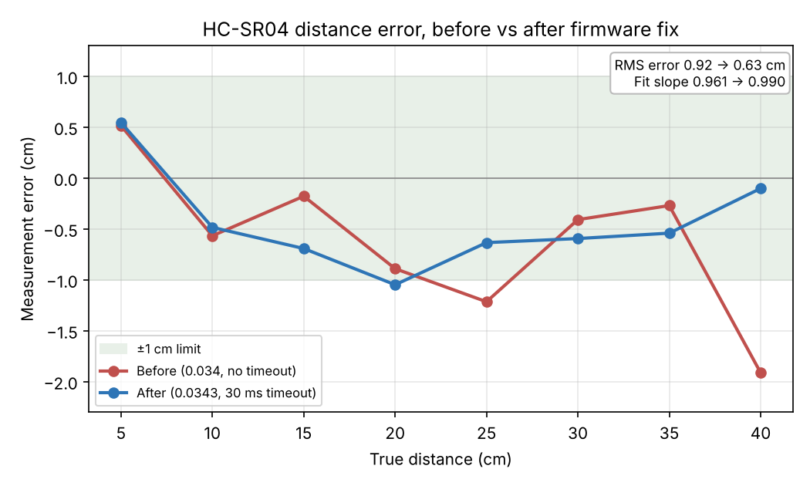

# ESP32 Ultrasonic Radar: Test Report

**Gurnit Chopra · October 2026**
Characterization of the [ESP32 ultrasonic radar](README.md) using a Digilent Analog Discovery 3 (AD3) and Python test automation.

## Summary

Six tests covered signal levels, distance accuracy, firmware timing, loop timing, servo PWM and supply stability. Three issues were found and fixed:

1. **ECHO overdrove the ESP32.** The sensor's ECHO pin put **5.05 V** into a 3.3 V GPIO. A resistor divider brought it to **3.41 V**.
2. **Distance read short at long range.** The speed-of-sound constant was about 1% low. Correcting it cut RMS error from **0.92 to 0.63 cm** and moved the fit slope from **0.961 to 0.990**.
3. **The loop stalled with nothing in range.** `pulseIn()` had no timeout, so each no-echo ping waited out the sensor's ~48 ms pulse. A 30 ms timeout cut the loop period from **~106 to ~86 ms**.

| # | Test | Limit | Before | After | Result |
|---|---|---|---|---|---|
| 1 | ECHO voltage at GPIO 14 | ≤ 3.6 V | 5.05 V | 3.41 V | Fixed |
| 2 | Distance accuracy (5 to 40 cm) | ±1 cm | 6/8 pass, max −1.91 cm | 7/8 pass, max −1.05 cm | Improved |
| 3 | Firmware echo timing vs AD3 | ±2% | +0.01% at 20 cm | n/a | Pass |
| 4 | TRIG width / ping interval | ≥ 10 µs / ≥ 60 ms | 12.7 µs / 62 ms | n/a | Pass |
| 4 | Loop period, no echo | Minimize | ~106 ms | ~86 ms | Improved |
| 5 | Servo PWM width | ±25 µs | −5 to −17 µs, 20.000 ms period | n/a | Pass |
| 6 | 5 V rail under servo load | ≥ 4.75 V | Min 4.93 V | n/a | Pass |

**Setup:** ESP32 dev board (USB powered), HC-SR04 (TRIG GPIO 27, ECHO GPIO 14), SG90 servo (GPIO 13), SSD1306 OLED (I²C, GPIO 32/33). AD3 with WaveForms and `dwfpy`. The test firmware adds a serial hold command (`H90` holds the servo, `S` resumes) and prints `angle,distance_cm,echo_us` for each ping.

---

## 1. ECHO voltage
AD3 scope on GPIO 14. The HC-SR04 runs from 5 V, and its ECHO output swung the full **5.05 V** into a 3.3 V input. After adding a resistor divider, the peak is **3.41 V**, and the pin still tracks the sensor edge for edge (confirmed in Test 4).

[before](test/data/echo-voltage/initial_echo_voltage.png) · [after](test/data/echo-voltage/final_echo_voltage.png) · [circuit before](test/data/echo-voltage/initial_circuit.jpg) · [circuit after](test/data/echo-voltage/final_circuit.jpg)

## 2. Distance accuracy
Servo held at 90°, flat target at 5 to 40 cm, 20 readings per point, logged by `test_distance.py`.

| True (cm) | 5 | 10 | 15 | 20 | 25 | 30 | 35 | 40 |
|---|---|---|---|---|---|---|---|---|
| Error before (cm) | +0.51 | −0.57 | −0.18 | −0.89 | **−1.22** | −0.41 | −0.27 | **−1.91** |
| Error after (cm) | +0.54 | −0.48 | −0.69 | −1.05 | −0.63 | −0.60 | −0.54 | −0.10 |

- **Speed of sound:** 0.034 cm/µs was about 1% below the value at room temperature (0.0343), so the error grew with distance. After the fix, the 40 cm error dropped from −1.91 to −0.10 cm.
- **Remaining offset:** about −0.5 cm at every distance, consistent with placing the target by hand against a ruler (±0.5 cm).
- **Cycle slips:** at some distances, readings flip between two exact values (e.g. 37.95 / 38.41 cm). The gaps are whole multiples of one 40 kHz cycle (0.43 cm), meaning the sensor sometimes detects a weak echo one or more cycles late. This is a sensor hardware limit, so it persists after the fix.
- **Repeatability:** away from cycle slips, the 20 readings at each point agree within about 0.02 cm.

[before CSV](test/data/distance-accuracy/distance_before.csv) · [after CSV](test/data/distance-accuracy/distance_after.csv) · [before plot](test/data/distance-accuracy/distance_before.png) · [after plot](test/data/distance-accuracy/distance_after.png)

## 3. Echo timing, AD3 vs firmware
`test_echo.py` captured 50 ECHO pulses with the AD3 at 1 MHz and compared them with 50 firmware `echo_us` readings.

| Target | AD3 mean | Firmware mean | Difference |
|---|---|---|---|
| 20 cm | 1085.8 µs | 1085.9 µs | **+0.01%** |
| ~2.5 cm | 155.7 µs | 155.0 µs | −0.44% |

The firmware's pulse timing is accurate, so the distance error in Test 2 comes from the conversion constant and the setup, not from timing.

[20 cm](test/data/echo-timing/echo_20cm.txt) · [2.5 cm](test/data/echo-timing/echo_2.5cm.txt)

## 4. Trigger and loop timing
AD3 logic analyzer on TRIG, ECHO and GPIO 14.

- **TRIG** is high for ~12.7 µs (datasheet minimum 10 µs). **ECHO** starts ~2.25 ms after TRIG, and GPIO 14 matches it exactly.
- **Normal ping interval:** ~62 ms, just above the 60 ms the datasheet recommends between pings.
- **No echo:** the sensor holds ECHO high for ~48 ms. Without a timeout, the loop waited the whole time (period ~106 ms). With a 30 ms timeout, the period is **~86 ms**, about 19% faster, and the timeout also prevents a 1 s freeze if the sensor fails.

[TRIG width](test/data/trigger-loop-timing/trig_width.png) · [20 cm echo](test/data/trigger-loop-timing/echo_20cm.png) · [normal loop](test/data/trigger-loop-timing/loop_period_normal.png) · [no-echo width](test/data/trigger-loop-timing/noecho_echo_width_before.png) · [no-echo loop before](test/data/trigger-loop-timing/noecho_loop_period_before.png) · [no-echo loop after](test/data/trigger-loop-timing/noecho_loop_period_after.png)

## 5. Servo PWM
AD3 scope on GPIO 13 at five held angles. Expected width = 500 + angle × 10.56 µs.

| Command | H15 | H45 | H90 | H135 | H165 |
|---|---|---|---|---|---|
| Expected (µs) | 658 | 975 | 1450 | 1925 | 2242 |
| Measured (µs) | 645.0 | 958.0 | 1445.0 | 1914.0 | 2226.9 |

The period is 20.000 ms at every angle, and all widths are within 5 to 17 µs of expected, a small consistent offset from the ESP32's PWM timer. The first H135 capture read 2011.9 µs; a recapture after the servo settled read 1914.0 µs (both captures kept). This test verifies the signal only, not the servo's physical angle.

[H15](test/data/servo_PWM/H15.png) · [H45](test/data/servo_PWM/H45.png) · [H90](test/data/servo_PWM/H90.png) · [H135](test/data/servo_PWM/H135.png) · [H135 outlier](test/data/servo_PWM/H135_outlier.png) · [H165](test/data/servo_PWM/H165.png)

## 6. 5 V rail droop
AD3 on the 5 V rail and servo signal while sweeping. The rail averages **5.12 V** and dips to **4.93 V** for ~1.5 ms after each servo pulse, as the servo's motor draws current. A falling trigger at 4.6 V never fired in about a minute, so narrow spikes in the low-rate overview were measurement noise. The rail stays within USB tolerance (≥ 4.75 V), so a separate servo supply is not needed.

[1 MHz dip](test/data/power-rail-droop/rail_dip.png) · [overview](test/data/power-rail-droop/rail_overview.png) · [notes](test/data/power-rail-droop/notes.txt)

---

## Test setup issues found along the way
- **Stale serial data:** readings piled up in the ESP32, USB and Windows buffers while the target was being moved, so early readings were from the previous position. The script now discards 1.5 s of data after each move.
- **Reset on port open:** opening the serial port auto-reset the ESP32 and cleared hold mode. The scripts now wait for boot and check that every reading is at 90°.
- **Isolation:** when readings first looked stuck, the AD3 showed the sensor responding correctly, and stripped-down sketches (sensor, plus servo, plus OLED) all read correctly. That ruled out the hardware and pointed to the serial pipeline.

## Changes made
- **Hardware:** resistor divider between HC-SR04 ECHO and GPIO 14.
- **Firmware:** `pulseIn(echoPin, HIGH)` → `pulseIn(echoPin, HIGH, 30000)`, and `0.034` → `0.0343`.

## Limitations
Target placement by hand (±0.5 cm), room temperature not measured (0.0343 assumes about 20 °C), servo physical angle not measured, and cycle slips not mitigated in firmware.

## Reproduce
Upload `src/radar.ino`, set `PORT` in the scripts, then run `python test/test_distance.py` (distance) or `python test/test_echo.py` (echo timing, AD3 channel 1 on ECHO, target at 20 cm). Tests 1, 4, 5 and 6 were run in WaveForms using the setups above.
